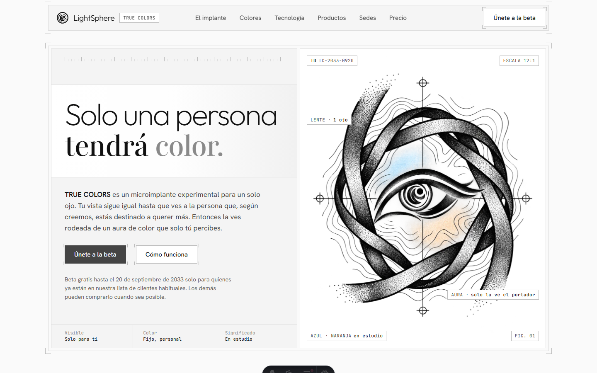
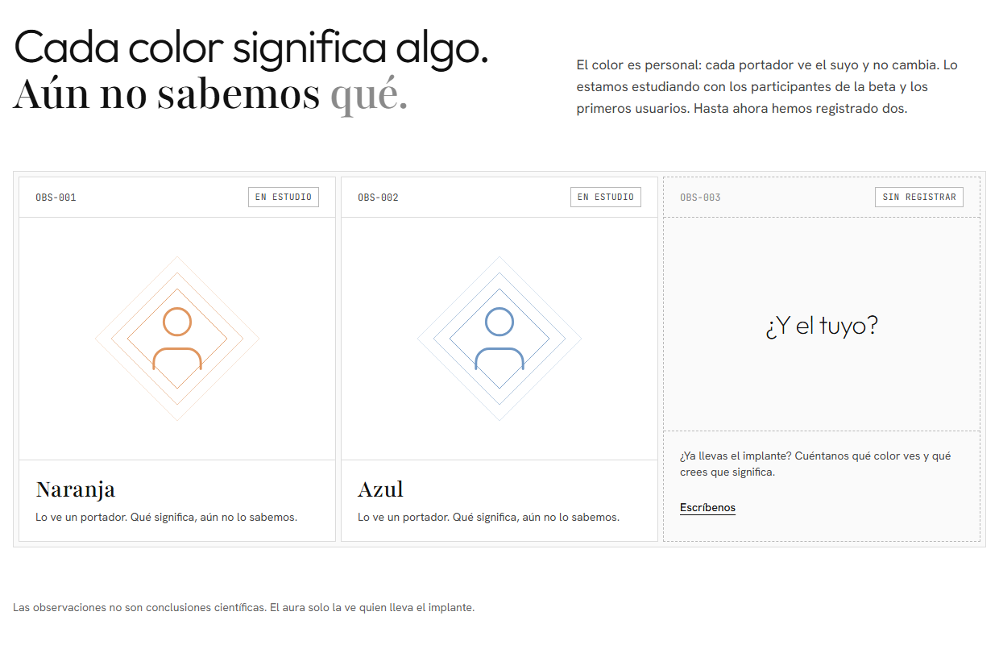
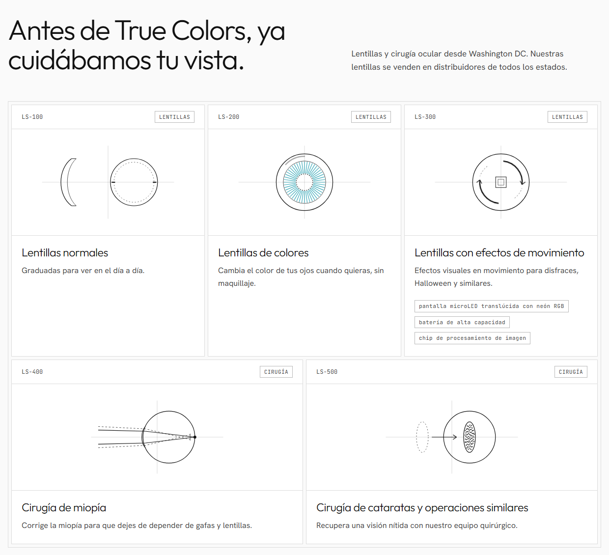
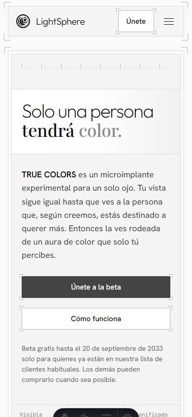

# LightSphere Landing

A one-page marketing site I designed and built for **LightSphere**, the company behind _TRUE COLORS_, an experimental single-eye micro-implant that lets you see an aura of colour around the one person you are meant to love.

The site is in Spanish, written in the brand's voice, and built to be fast, accessible and easy for the client to keep editing.



<p align="center">
  
  
</p>

<p align="center">
  
</p>

## What I delivered

- A complete landing page: hero, how the implant works, colour guide, technology, FAQ, beta sign-up, products, locations and pricing.
- Legal pages (`/aviso-legal`, `/privacidad`).
- A small design system: tokens, component classes and keyframes in one stylesheet, with chamfered "clipped corner" components as the visual signature.
- SEO basics: configurable title and description, `robots` control (legal pages are `noindex`) and favicons.
- A content layer the client can edit without touching markup: all copy for products, locations, steps, specs and FAQs lives in `src/consts.ts`.

## Design decisions

- **Monochrome base, colour as the payoff.** The page is paper, ink and graphite. Colour appears only as the "aura" accents, which mirrors the product's idea: the world looks the same until it doesn't.
- **Four-font system.** Outfit for display, Playfair Condensed for editorial emphasis, Hanken Grotesk for body text and JetBrains Mono for labels and specs.
- **Accessibility first.** Skip link, labelled sections, semantic landmarks and `jsx-a11y` linting via `bun run lint`.
- **Unknown facts stay visibly unknown.** Details the client hasn't confirmed (address, email, screen specs, book link) are bracketed placeholders such as `[DIRECCIÓN]` or `[EMAIL]`, so nothing invented ships by accident.

## Stack

| Area      | Choice                               |
| :-------- | :----------------------------------- |
| Framework | [Astro](https://astro.build) 7       |
| Styling   | Tailwind CSS 4 (via the Vite plugin) |
| Icons     | `@lucide/astro`                      |
| Language  | TypeScript                           |
| Quality   | ESLint (Astro + jsx-a11y), Prettier  |
| Tooling   | Bun, Node >= 22.22                   |

## Project structure

```text
src/
├── components/   One component per page section (Hero, Implante, FAQ, Precios...)
├── layouts/      Base layout and legal-page layout
├── pages/        index, aviso-legal, privacidad
├── styles/       global.css: tokens, component classes, keyframes
└── consts.ts     Editable site content and SEO metadata
public/           Fonts, images and favicons
```

## Running it

```sh
bun install
bun run dev    # http://localhost:4321
bun run build  # production build to ./dist
bun run preview # preview the build
bun run lint   # ESLint
bun run format # Prettier
```

## Deploying to Cloudflare Pages

The site is fully static, so no adapter is needed. In the Cloudflare dashboard go to Workers & Pages > Create > Pages > Connect to Git, pick this repo and use:

| Setting                | Value           |
| :--------------------- | :-------------- |
| Production branch      | `master`        |
| Framework preset       | Astro           |
| Build command          | `bun run build` |
| Build output directory | `dist`          |

`.node-version` pins Node. Or deploy from the terminal (`wrangler.jsonc` points at `dist`):

```sh
bun run build
bunx wrangler pages deploy
```

Once the domain is known, set `site` in `astro.config.mjs` and add the custom domain in the Pages project.

## Still pending from the client

Placeholders left in the copy until the client supplies the real values: the location address (`[DIRECCIÓN]`) and the book link (`[ENLACE LIBRO]`), both in `src/components/Sedes.astro`.

## Status

Built and ready for content sign-off. `site` in `astro.config.mjs` is set to `https://truecolors.pro`; confirm it matches the final domain.

## License

[MIT](LICENSE) © 2026 Xabier Figueroa
